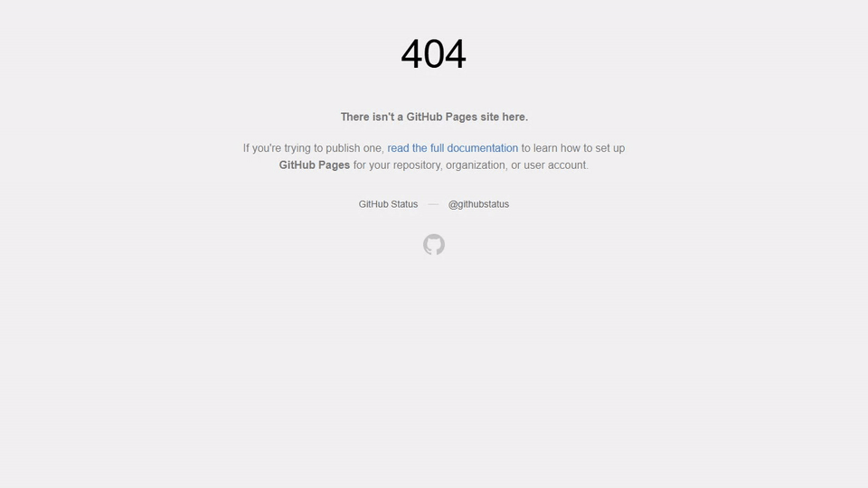
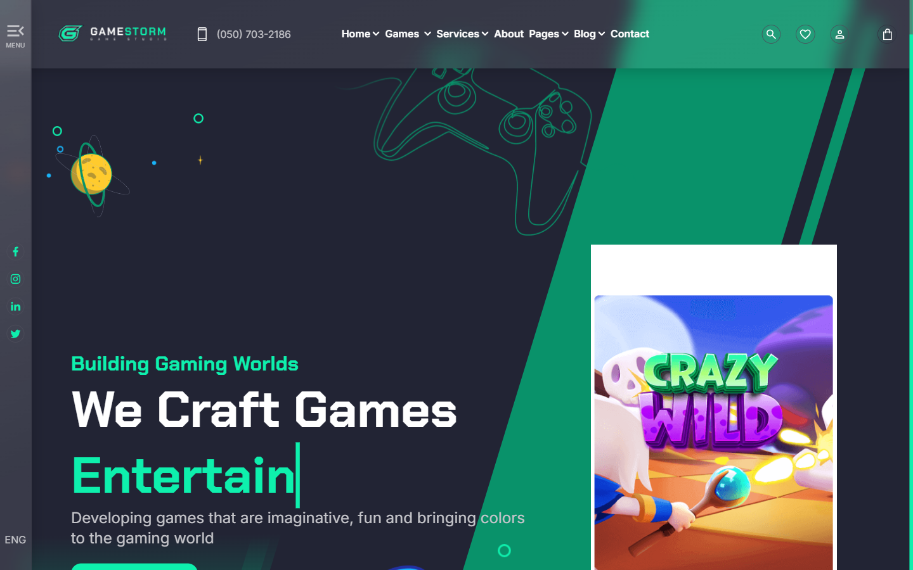
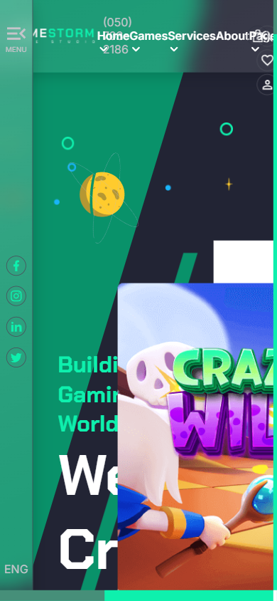
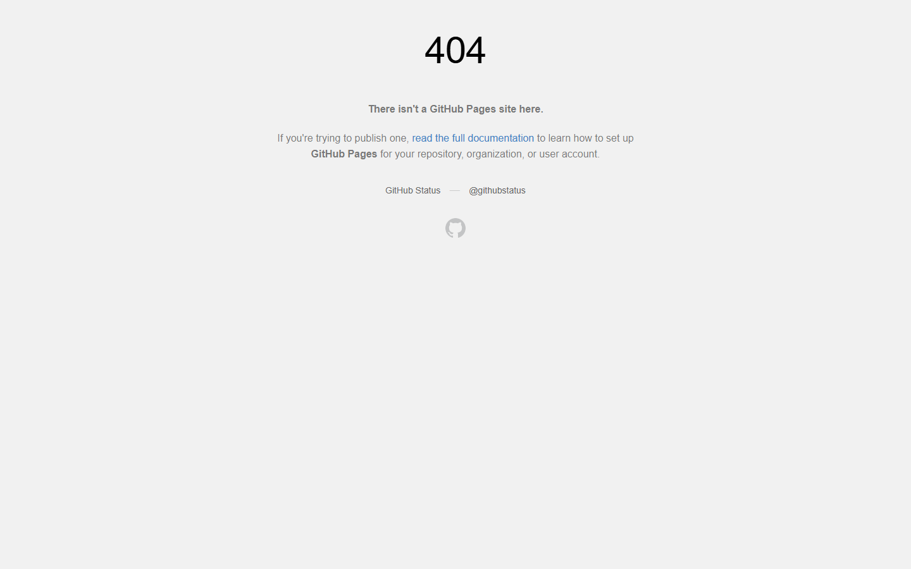
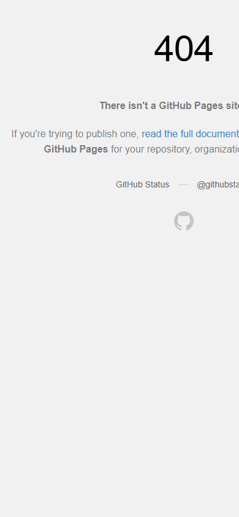

# GameStorm — Gaming Studio Landing Page

A long-form landing page for a fictional game studio: hero with typewriter headline, feature blocks, game showcase, team, testimonials, stats and store CTAs.

**Live demo:** https://final-project-mister2314.vercel.app/

<div align="center">



| Desktop | Mobile |
|---|---|
|  |  |

<details>
<summary>More screenshots</summary>

| Desktop | Mobile |
|---|---|
|  |  |

</details>

</div>

## What it does

Twelve sections on one dark arcade page — hero, about, game showcase, team, stats, services, gallery, contact and footer, laid out with CSS grid and flexbox. The identity is a deep navy stage with one neon-mint accent (`#0ef0ad`) and Chakra Petch doing the display work.

The JavaScript stays small on purpose. Every section reveal runs through one motion system: an IntersectionObserver marks elements visible once, and CSS transitions carry the rest — short 0.6s rises for copy, a longer staged zoom for the hero. Nothing re-animates when you scroll back up, so the page settles and stays readable.

## Tech stack

React 19 · TypeScript · Vite

## Features

- Twelve-section marketing layout in one page, CSS grid and flexbox throughout
- Typewriter headline effect with randomized typing speed
- Double custom cursor (ring + dot) on fine-pointer devices
- One unified reveal system for all 94 animated elements, with rhythm tokens and `prefers-reduced-motion` support
- Animated stat counters (652+ daily users, 50K downloads, 200+ games, 350K projects) with tabular digits so they don't jitter while counting
- Lazy-loaded images with explicit dimensions everywhere — the page ships ~3.6 MB of media after a WebP pass, down from ~85 MB
- Contact form via EmailJS, with a `beforeunload` guard so an unsent message is never lost by accident
- Back-to-top button that appears past the hero

## Accessibility & motion

- Every reveal has a static equivalent: with reduced motion on, all content is simply visible
- Interactive elements have visible mint focus rings; the hero CTA is a real anchor that scrolls to the games section
- The custom cursor is disabled on touch so mobile keeps the native pointer

## Run locally

```bash
git clone https://github.com/Mister2314/Final-Project.git
cd Final-Project
npm install
npm run dev      # dev server
npm run build    # type-check + production build to dist/
npm run preview  # serve the production build
```

## Structure

```
src/
  components/   # Hero, Section2..Section12, Header, Footer, ClickTop
  hooks.ts      # reveals, typewriter, cursor, counters, form guard
  aos.css       # the reveal motion system
  style.css     # layout and theme
assets/img/     # WebP-optimised media
```
